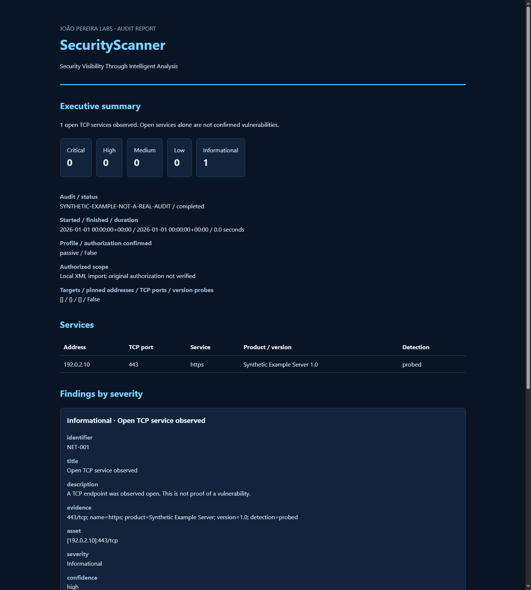

# SecurityScanner

[Documentação em português](README.md)

**João Pereira Labs · Security Visibility Through Intelligent Analysis**

A local Python CLI for explicitly authorized TCP service inventories, passive Nmap XML
analysis, and reproducible security reports. Built by [João Pereira](https://github.com/joaopereiralabs).

## Actual development status

**v0.2.0 — Network Scanner, with early reporting/history support.** Not a stable v1.0
release. Foundation and network milestones are implemented. HTTP/TLS analysis, advisory
correlation, and a Textual TUI are planned and are **not** implemented. There are no
TUI screenshots because there is no TUI yet; `ui` reports this and exits with code 2.

Implemented:

- Installable Typer/Rich CLI, environment doctor, validated settings and scope.
- Exact-host allow lists, explicit authorization, DNS pinning/revalidation, maximum
  16 resolved IPs per audit. No CIDR ranges or arbitrary Nmap arguments.
- Sequential Nmap TCP connect scans, configurable 1–32 ports, optional service probes,
  per-process deadlines and Ctrl+C cleanup.
- Passive local XML import with entity/external reference protection and size limits.
- Informational, evidence-based service findings; no fabricated CVEs or CVSS scores.
- Local SQLite history, audit events, coverage-aware comparisons.
- Offline HTML with Dark Blue styling and print CSS, JSON and Markdown reports.
- Offline tests and an opt-in real Nmap integration test against a loopback server.

## Requirements and Kali Linux installation

Python **3.11+**, pip/venv, and Nmap for active scans. Kali, Debian and Ubuntu are intended
platforms. Local validation details and platform limitations are in
[VALIDATION.md](docs/VALIDATION.md). No account, remote server or API key is required.

```bash
sudo apt update
sudo apt install -y python3 python3-venv git nmap
git clone https://github.com/joaopereiralabs/security-scanner.git
cd security-scanner
python3 -m venv .venv
source .venv/bin/activate
python -m pip install -e '.[dev]'
securityscanner doctor
securityscanner --help
```

If using the source archive before publication, extract it and start at `cd security-scanner`.
Do not run the application as root. Active scanning uses TCP connect and unprivileged mode.

## Usage

Review operations with `securityscanner profiles`. Authorization and the explicit allow list
are both mandatory for active scans, even for loopback targets. Repeated `--target` and
`--allow` flags accept multiple exact hosts; a hostname entry approves its initial DNS IPs.

```bash
securityscanner scan --target 127.0.0.1 --allow 127.0.0.1 --authorized --profile basic
securityscanner scan --target localhost --allow localhost --authorized --ports 8000 --versions
securityscanner scan --profile passive --import-xml examples/synthetic-nmap.xml
securityscanner history
securityscanner report --scan-id SCAN_ID --format html --output audit.html
securityscanner report --scan-id SCAN_ID --format json --output audit.json
securityscanner report --scan-id SCAN_ID --format markdown --output audit.md
securityscanner compare --scan-a ID1 --scan-b ID2
```

The supplied XML and [example HTML report](examples/synthetic-report.html) are explicitly
**synthetic documentation data**, never represented as a real audit. Live results are generated
only by running a scan or importing your own evidence.

Actual browser rendering of the synthetic report (this is a report preview, not a TUI):



Defaults: ports `22,80,443,8080,8443`, one host and one port probe at a time,
maximum scan rate 10 packets/s, one retry, 90 seconds per IP. CLI bounds: timeout 5–300
seconds, max rate 1–20, at most 32 explicit ports. With 16 addresses the run can take up
to 16 task deadlines plus bounded DNS resolution and cleanup; there is no overall deadline.

`--versions` opts into Nmap `-sV --version-intensity 0`: active application probes may be
sent. Nmap's scan rate limit does **not** provide a strict application-request budget.
The default scan only reports Nmap's port-table service label; `detection=table` is not a
verified service identity. Nmap may use built-in version-detection behavior; no user-supplied
NSE scripts, exploitation options or arbitrary switches are accepted.

Passive mode only parses local XML and writes local results. It does not resolve names,
invoke Nmap, or contact any target. Only complete successful Nmap XML is accepted.
Imported files are not proof of their origin, authorization, timestamp or coverage. Only
open TCP services and selected identity fields are retained; scripts, MAC addresses,
raw fingerprints, hostname details and unrelated XML content are discarded.

## Data, errors and limitations

Data defaults to `${XDG_DATA_HOME:-$HOME/.local/share}/securityscanner`. Override with
`SECURITYSCANNER_DATA_DIR=/path/to/private/data`. SQLite stores schema-versioned validated
JSON records transactionally; `audit.jsonl` stores lifecycle, approved scope and exact argv.
New directories/files use private POSIX modes. Windows relies on inherited ACLs. Data is
not encrypted, and existing permissions are not silently changed. Review retention and
file access. Logs have no automatic rotation yet. Service identity strings may contain
attacker-controlled text; inspect before sharing reports. Version probing is opt-in.

Exit codes: 0 success, 1 incomplete doctor checks, 2 validation/execution error or planned
feature, 130 cancellation. Partial services remain available in failed/cancelled reports,
but cannot be compared. Hard kills or power loss can leave a record `running`; do not
interpret it as completed. Reports never overwrite existing files.

Comparisons require identical profile, pinned addresses, ports and version mode. Changes
in product/version on the same endpoint are not separate findings. "No longer observed"
is an observation, **not proof of remediation**. Passive coverage cannot be verified.

No independent host-discovery sweep, UDP, subnet scans, HTTP redirect following, TLS
certificate inspection, exploit validation, brute force, credentials collection or external
advisory lookup is implemented. Empty output cannot prove a host is down or secure.
DNS uses the configured OS resolver for active hostname scans; IP targets avoid DNS.

## Architecture

```text
CLI → orchestrator → scope approval/revalidation → Nmap adapter
                         ↓                          ↓
                  SQLite + audit log ← models ← XML parser
                         ↓                ↓
                    comparison       findings → reports
```

`core` owns policy and lifecycle; `scanners` owns execution and parsing; `analyzers` turns
observations into cautious findings; `storage` persists models; `reports` renders exports;
`cli` handles interaction. No empty plugin interfaces or placeholder scanner classes are
included. See [architecture and threat model](docs/ARCHITECTURE.md) and the
[reviewed roadmap](docs/ROADMAP.md).

## Development

```bash
python -m pip install -e '.[dev]'
ruff check .
ruff format --check .
mypy
pytest -q
SECURITYSCANNER_NMAP_TEST=1 pytest -q
python -m build
```

The default suite needs no public network or installed Nmap. The optional integration test
starts its own loopback TCP greeting service, explicitly authorizes that single IP and scans its
ephemeral TCP port. CI runs both on Ubuntu and Python 3.11–3.13. CI configuration is not a
claim that remote CI has already passed. Dependency bounds live in `pyproject.toml`; the
tested environment snapshot is recorded separately without claiming a universal lockfile.

## Roadmap and contributing

- v0.1: foundation — implemented and reviewed.
- v0.2: network scanner — implemented; platform validation remains limited.
- v0.3: HTTP/TLS — next milestone, including pinned transports and redirect scope checks.
- v0.4: reporting — early implementation here; future web evidence and migrations remain.
- v0.5: Textual dashboard and task cancellation — planned.
- v1.0: independent security review and broader compatibility validation — planned.

Read [CONTRIBUTING.md](CONTRIBUTING.md), [SECURITY.md](SECURITY.md) and
[CHANGELOG.md](CHANGELOG.md). Licensed under [MIT](LICENSE).

**Authorized use only.** Only assess systems you own or have explicit permission to audit.
An authorization flag records an operator assertion; it cannot verify legal permission.
